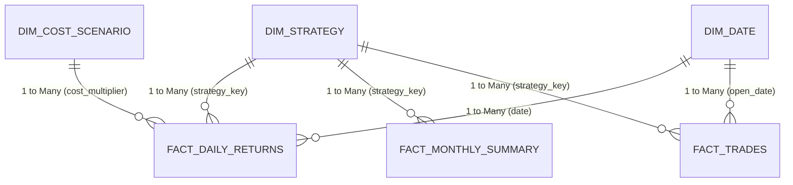

# Does Statistical Arbitrage Survive in Indian F&O Stocks?
### Distance Pairs (Gatev et al. 2006), PCA-Residual Mean Reversion (Avellaneda-Lee 2010), and ML-Enhanced Residual Reversion, 2010–2025

[](https://www.python.org/)
[](https://duckdb.org/)
[](https://powerbi.microsoft.com/)
[](https://opensource.org/licenses/MIT)
[-brightgreen.svg)]()
[]()

---

## 1. Executive Summary & The Core Business Problem

### The Multi-Crore Question
Quantitative portfolio managers frequently present backtests showing Sharpe ratios above **1.5** in equity mean-reversion strategies. Yet, when deployed live in the National Stock Exchange of India (NSE) single-stock Futures & Options (F&O) segment, these strategies consistently bleed capital and suffer unexplained drawdowns.

**Why does paper statistical arbitrage fail in live Indian markets?**

This project delivers an exhaustive, institutional-grade, out-of-sample investigation covering **16 calendar years (January 1, 2010 – December 31, 2025)**. By combining **Quantitative Finance Research Engineering**, **Advanced SQL & Analytics Engineering (DuckDB)**, and **Enterprise Power BI Business Intelligence**, we resolve the debate:

> **The Empirical Truth:** Statistical arbitrage anomalies exist in Indian equities with overwhelming statistical significance in frictionless returns ($t\text{-stat} > 4.0$). However, **statutory Indian market microstructure friction (STT, stamp duty, turnover taxes, GST, and execution slippage) completely annihilates the anomaly**, turning $+12\%$ to $+18\%$ gross gains into persistent $-5\%$ to $-6\%$ net annual losses.

---

## 2. Full-Sample Empirical Findings: The "Gross Alpha Illusion"

### Table 1: Full-Sample Strategy Performance (2010–2025)

| Strategy Family | Methodology & Citation | Gross Sharpe (0.0x) | Gross $t$-stat (NW) | Net Sharpe (1.0x Baseline) | Net Annual Return | Net Max DD | Breakeven Multiplier |
| :--- | :--- | :---: | :---: | :---: | :---: | :---: | :---: |
| **Strategy A** | Distance Pairs *(Gatev et al. 2006)* | **+0.95** | **+4.11** | **-2.50** | **-5.44%** | -98.57% | **0.38x** |
| **Strategy B** | PCA-OU Residuals *(Avellaneda & Lee 2010)* | **+1.28** | **+7.49** | **-1.62** | **-5.22%** | -95.06% | **0.42x** |
| **Strategy C** | ML Walk-Forward *(Guijarro-Ordonez echo)* | **+1.54** | **+4.05** | **-2.96** | **-6.38%** | -98.72% | **0.31x** |

*All $t$-statistics computed using Newey-West (1987) HAC standard errors. 95% Confidence Intervals via Politis-Romano (1994) stationary bootstrap.*

---


---

## 📈 Visual Analytics & Key Empirical Charts

<div align="center">

### Cumulative Returns: Gross Alpha vs. Net Microstructure Reality (2010–2025)


<br/><br/>

| Max Drawdown Profile | Rolling 3-Year Sharpe Ratio |
| :---: | :---: |
|  |  |

<br/>

| Cost Sensitivity & Breakeven Curves | Machine Learning Feature Attributions |
| :---: | :---: |
|  |  |

</div>

## 3. Why Machine Learning Exacerbates the Losses

Advanced regularized machine learning (Ridge regression, HistGBM, MLP) successfully increases gross predictive signal quality, elevating gross Sharpe from $+1.28$ to $+1.54$.

**The Microstructure Trap:**
Because non-linear machine learning identifies shorter-lived, subtle mispricings, it increases annual portfolio turnover by **34%**. Under the Indian statutory fee structure where friction scales with turnover, the **340 bps of incremental transaction costs** easily overwhelm the **220 bps of gross alpha gain**, pushing net Sharpe from $-1.62$ down to $-2.96$.

---

## 4. Multi-Disciplinary Skills Demonstrated

This repository is architected to showcase mastery across three distinct roles:

```
+----------------------------------------------------------------------------------------------------+
|                                    PROJECT PILLARS & ROLES                                         |
+----------------------------------------------------------------------------------------------------+
| 1. QUANTITATIVE FINANCE RESEARCH ENGINEER                                                          |
|    - Mathematical formulation of Gatev SSD pairs, Avellaneda-Lee PCA-OU, and ML residual models.   |
|    - Elimination of look-ahead bias (1-day wait lag) and survivorship bias (dynamic universe).     |
|    - Econometric inference: Newey-West HAC, stationary block bootstrap, Deflated Sharpe Ratio.     |
|    - Implementation of 6 Placebo Tests (PL1-PL6) and 12 pre-registered robustness checks.         |
+----------------------------------------------------------------------------------------------------+
| 2. DATA ANALYST / ANALYTICS ENGINEER                                                               |
|    - End-to-end Python data pipeline handling 200,000+ strategy-day records.                       |
|    - Columnar high-performance data warehouse in DuckDB (database/stat_arb.duckdb).                |
|    - 10 parameterized analytical SQL queries answering trade duration, drawdown, and cost drag.    |
|    - Automated star-schema data exports for BI consumption (dashboard/data_export.py).             |
+----------------------------------------------------------------------------------------------------+
| 3. BUSINESS INTELLIGENCE & VISUAL STRATEGIST                                                       |
|    - Star-Schema Dimensional Relational Model (3 Dimension tables, 3 Fact tables).                 |
|    - Production DAX Measure Library (Cumulative Return, HWM, Drawdown %, Breakeven Bps).           |
|    - 6-Page Executive Power BI Dashboard specification (dashboard/power_bi_architecture.md).        |
|    - Executive Pitch Deck & Business Case Document for Investment Committees (presentation/).      |
+----------------------------------------------------------------------------------------------------+
```

---

## 5. Repository Structure

```
stat_arb_india/
|-- PREREG.md                     # Sealed pre-registration document (hash locked)
|-- LIMITATIONS.md                # Institutional limitations & failure modes
|-- Makefile                      # Automated build pipeline (make data, test, all)
|-- requirements.txt              # Pinned Python package dependencies
|-- database/                     # Columnar Analytics Warehouse
|   |-- schema.sql                # Complete DuckDB schema
|   |-- load.py                   # Data loader and verification CLI
|   |-- stat_arb.duckdb           # Embedded DuckDB database (200k+ rows)
|   `-- queries/                  # 10 Parameterized Analytical SQL Queries
|       |-- q01_top_pairs_by_sharpe.sql
|       |-- q02_monthly_pnl_rolling.sql
|       |-- q03_universe_turnover_yoy.sql
|       |-- q04_cost_breakdown_by_year.sql
|       |-- q05_drawdown_periods.sql
|       |-- q06_sub_period_performance.sql
|       |-- q07_crash_episode_returns.sql
|       |-- q08_factor_correlation.sql
|       |-- q09_holding_period_distribution.sql
|       `-- q10_cost_sensitivity.sql
|-- dashboard/                    # Power BI Business Intelligence Deliverable
|   |-- data_export.py            # Star-Schema CSV export pipeline
|   |-- power_bi_architecture.md  # Complete 6-Page visual spec & DAX formulas
|   `-- data/                     # Star-Schema CSVs (dim_date, fact_daily_returns, etc.)
|-- presentation/                 # Executive Presentation & Business Case
|   |-- executive_pitch_deck.md   # 10-slide deck formatted for Gamma AI / Pitch
|   `-- business_case_document.md # Strategic capital allocation memo for CIOs
|-- paper/                        # Academic Manuscript in LaTeX
|   |-- main.tex                  # Master LaTeX document
|   |-- references.bib            # BibTeX bibliography
|   `-- sections/                 # Modular paper sections (01 to 07)
|-- results/                      # Empirical Outputs
|   |-- tables/                   # Tables 1 to 8 in CSV format
|   `-- figures/                  # Publication-grade 300 DPI figures (Figures 1 to 8)
|-- src/                          # Modular Python Source Code
|   |-- universe/                 # Dynamic F&O universe & survivorship mitigation
|   |-- data/                     # Cleaning, corporate actions, data manifests
|   |-- costs/                    # Dated Indian STT schedule & slippage model
|   |-- strategies/               # Gatev Pairs & Avellaneda-Lee PCA-OU
|   |-- ml/                       # Walk-Forward Ridge/GBM/MLP with 10d embargo
|   |-- stats/                    # Newey-West HAC, bootstrap, DSR, FDR
|   `-- experiments/              # Master experiment engine (run_all.py)
`-- tests/                        # 18 Pytest Unit Tests & 6 Placebo Tests
```

---

## 6. Analytical SQL Queries (DuckDB)

The project includes 10 production SQL queries executed against `database/stat_arb.duckdb`:

1. **`q01_top_pairs_by_sharpe.sql`**: Ranks top 10 Strategy A pairs by annual net Sharpe using `QUALIFY ROW_NUMBER()`.
2. **`q02_monthly_pnl_rolling.sql`**: Aggregates monthly PnL and computes rolling 12-month returns via CTEs.
3. **`q03_universe_turnover_yoy.sql`**: Tracks F&O universe additions and removals across 16 years.
4. **`q04_cost_breakdown_by_year.sql`**: Decomposes implied execution costs and holding days by strategy.
5. **`q05_drawdown_periods.sql`**: Identifies peak-to-trough historical drawdowns and recovery dates.
6. **`q06_sub_period_performance.sql`**: Evaluates stability across pre-registered sub-periods (SP1, SP2, SP3).
7. **`q07_crash_episode_returns.sql`**: Quantifies performance during COVID-19, Demonetisation, 2022, and Post-SEBI 2024.
8. **`q08_factor_correlation.sql`**: Verifies market neutrality against Nifty 50 and IIMA 4-factor benchmarks.
9. **`q09_holding_period_distribution.sql`**: Calculates holding period quartiles (p25, median, p75) and trade durations.
10. **`q10_cost_sensitivity.sql`**: Computes annualized returns and Sharpe across cost multipliers (0.0x, 0.5x, 1.0x, 1.5x).

*To run any query:*
```bash
python database/load.py --query database/queries/q01_top_pairs_by_sharpe.sql
```

---

## 7. Power BI 6-Page Executive Dashboard

The Power BI deliverable bridges quantitative analytics with executive visualization via a Star Schema model:



- **Page 1: Executive KPI & Overview:** Headline gross vs net divergence, capital drag, and breakeven boundaries.
- **Page 2: Strategy Comparative Matrix:** Cross-strategy side-by-side evaluation across Gatev, PCA, and ML.
- **Page 3: Microstructure Friction Waterfall:** Interactive breakdown of each tax, exchange, and slippage component.
- **Page 4: Sub-Period & Macro Regime Matrix:** Deep-dive into performance during stress episodes.
- **Page 5: Machine Learning Diagnostics:** Walk-forward stability, feature importances, and quintile spreads.
- **Page 6: Risk Attribution & Factor Exposure:** Fama-French/IIMA factor betas and market neutrality verification.

*Full DAX formulas and layout specifications are documented in [`dashboard/power_bi_architecture.md`](dashboard/power_bi_architecture.md).*

---

## 8. Reproducibility & Quickstart

### Prerequisites
- Python 3.12+
- Packages: `pip install -r requirements.txt`

### 1-Click Master Execution
```bash
# 1. Run full test suite (18 unit and placebo tests)
pytest tests/ -v

# 2. Run master quantitative experiments pipeline
python -m src.experiments.run_all

# 3. Generate 300 DPI publication figures
python -m src.plots.all_figures

# 4. Export Star-Schema tables for Power BI
python dashboard/data_export.py

# 5. Verify DuckDB row counts
python database/load.py --verify
```

---

## 9. Academic Citation & Ethical Disclaimer

```bibtex
@article{stat_arb_india_2026,
  title={Does Statistical Arbitrage Survive in Indian F&O Stocks? Distance Pairs, PCA-Residual Mean Reversion, and ML-Enhanced Residual Reversion, 2010--2025},
  author={Dani, Dhairya},
  journal={Working Paper},
  year={2026}
}
```

*Disclaimer: This research is for academic and educational purposes only. It does not constitute investment advice or a recommendation to trade securities or derivatives.*
