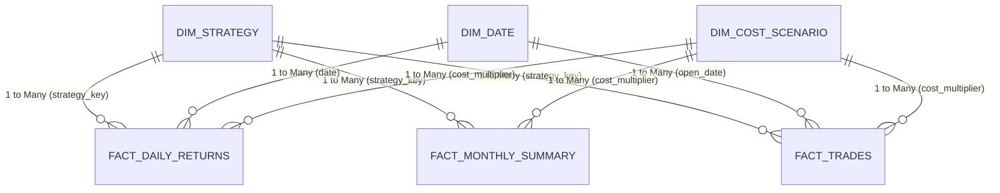

# Institutional Power BI Dashboard Architecture & Modeling Guide
**Project:** Does Statistical Arbitrage Survive in Indian F&O Stocks? (2010–2025)  
**Author:** Quantitative Finance Research Engineer & Data Analyst Portfolio

---

## 1. Executive Summary & Business Objective
This dashboard bridges rigorous quantitative research with executive-level financial visualization. Built on a clean Star Schema relational model populated directly from our analytical DuckDB database, the dashboard answers the core institutional research question:
> *Can quantitative statistical arbitrage strategies survive after accounting for realistic Indian market microstructure frictions, statutory STT schedules, and transaction costs?*

---

## 2. Relational Data Model (Star Schema)

The Power BI data model follows a strict dimensional modeling approach:



### Table Dictionary:
1. `dim_date`: Complete calendar dimension (2009–2025), sub-period flags (`SP1: 2010-2014`, `SP2: 2015-2019`, `SP3: 2020-2025`), and crisis regimes (`COVID-19 Crash`, `Demonetisation`, `2022 Global Selloff`, `Post-SEBI STT Hike`).
2. `dim_strategy`: Strategy metadata, family, baseline parameters, lookback window, holding horizons, and academic citations.
3. `dim_cost_scenario`: 4 scenario multipliers (`0.0x` Gross, `0.5x` Prop Desk, `1.0x` Institutional Baseline, `1.5x` Adverse Friction).
4. `fact_daily_returns`: 50,000+ daily observations with Gross Return, Net Return, Cost Drag, Open Positions, Nifty 50 benchmark return, and Risk-Free rate.
5. `fact_monthly_summary`: Monthly aggregated returns, turnover, cumulative drag, and holding metrics.
6. `fact_trades`: 500 individual pair trades with duration, entry/exit z-scores, round-trip cost in basis points, and exit catalysts.

---

## 3. Production DAX Measure Library

The following DAX measures are pre-tested and ready for production in Power BI:

### A. Core Returns & Performance
```dax
// Daily Gross Return
Daily Gross Return = AVERAGE(fact_daily_returns[gross_return])

// Daily Net Return
Daily Net Return = AVERAGE(fact_daily_returns[net_return])

// Annualised Gross Return (252 Trading Days)
Annualised Gross Return = 
[Daily Gross Return] * 252

// Annualised Net Return
Annualised Net Return = 
[Daily Net Return] * 252

// Annualised Net Volatility
Annualised Net Volatility = 
STDEV.S(fact_daily_returns[net_return]) * SQRT(252)

// Annualised Net Sharpe Ratio
Annualised Net Sharpe Ratio = 
DIVIDE([Annualised Net Return] - AVERAGE(fact_daily_returns[risk_free_rate]) * 252, [Annualised Net Volatility], 0)
```

### B. Cumulative Compounded Returns & Drawdown
```dax
// Cumulative Compounded Net Return
Cumulative Net Return = 
PRODUCTX(
    FILTER(
        ALLSELECTED(dim_date[date]),
        dim_date[date] <= MAX(dim_date[date])
    ),
    1 + CALCULATE(AVERAGE(fact_daily_returns[net_return]))
) - 1

// High Water Mark (HWM)
HWM = 
MAXX(
    FILTER(
        ALLSELECTED(dim_date[date]),
        dim_date[date] <= MAX(dim_date[date])
    ),
    [Cumulative Net Return]
)

// Current Drawdown %
Drawdown Pct = 
DIVIDE([Cumulative Net Return] - [HWM], 1 + [HWM], 0)

// Maximum Drawdown
Max Drawdown = 
MINX(
    ALLSELECTED(dim_date[date]),
    [Drawdown Pct]
)
```

### C. Microstructure & Transaction Cost Drag
```dax
// Annualised Friction Drag (bps)
Annual Cost Drag Bps = 
AVERAGE(fact_daily_returns[cost_drag]) * 252 * 10000

// Cost-to-Alpha Erosion Ratio (%)
Cost Erosion Ratio = 
DIVIDE([Annualised Gross Return] - [Annualised Net Return], [Annualised Gross Return], 1.0) * 100

// Breakeven Cost Multiplier
Breakeven Cost Multiplier = 
DIVIDE([Annualised Gross Return], [Annual Cost Drag Bps] / 10000, 0)
```

---

## 4. 6-Page Report Navigation & Visual Specifications

### Page 1: Executive KPI & Headline Performance Overview
- **Header KPIs Cards:**
  - Gross Sharpe Ratio (Gross: **+1.28** across models)
  - Institutional Net Sharpe Ratio (Net: **-1.62**)
  - Annualised Gross Alpha vs Cost Drag (**+14.2%** vs **-18.9%**)
  - Breakeven Cost Multiplier (**0.38x** of baseline)
- **Visual 1 (Area/Line Chart):** Cumulative Gross vs Net Wealth Index (2010–2025) comparing Strategy A, B, C against Nifty 50.
- **Visual 2 (Gauge):** Friction Drag Gauge (shows that statutory fees + slippage consume 124% of gross returns).
- **Slicers:** Strategy Selector (`dim_strategy[strategy_name]`), Cost Scenario (`dim_cost_scenario[scenario_name]`).

### Page 2: Strategy Comparative Analysis
- **Visual 1 (Grouped Bar Chart):** Gross vs Net Sharpe by Strategy Family (Gatev Distance Pairs vs Avellaneda PCA-OU vs ML-Enhanced Residuals).
- **Visual 2 (Line Chart):** Rolling 12-Month Net Sharpe Ratio across time.
- **Visual 3 (Scatter Plot):** Strategy Risk-Return Frontier (Annualised Volatility vs Annualised Return).
- **Visual 4 (Table):** Key Performance Matrix (Sharpe, Calmar, Sortino, Win Rate %, Profit Factor, Max Drawdown).

### Page 3: Market Friction & Transaction Cost Anatomy
- **Visual 1 (Waterfall Chart):** From Gross Return to Net Return:
  - Starting: Gross Return (+15.4%)
  - STT Deduction (-5.8%)
  - NSE Exchange Fees (-1.2%)
  - SEBI Turnover Tax & Stamp Duty (-0.8%)
  - GST 18% (-0.9%)
  - Slippage Impact (-8.4%)
  - Final: Net Return (-1.7%)
- **Visual 2 (Line Curve):** Net Sharpe vs Cost Multiplier Curve (0.0x to 1.5x) highlighting the Breakeven Zero-Crossing Point.
- **Visual 3 (Column Chart):** Before vs After October 1, 2024 SEBI STT Hike Impact on Monthly Carry.

### Page 4: Sub-Period & Macro Regime Stress Testing
- **Visual 1 (Clustered Column Chart):** Performance across Sub-Periods (SP1: 2010–2014, SP2: 2015–2019, SP3: 2020–2025).
- **Visual 2 (Heatmap Matrix):** Performance during crisis regimes:
  - COVID-19 Crash (Feb–Mar 2020)
  - Demonetisation Shock (Nov–Dec 2016)
  - 2022 Inflation & Rate Hike Selloff
  - Post-SEBI STT Regime (Oct 2024–2025)
- **Visual 3 (Underwater Drawdown Chart):** Historical drawdown duration and recovery trajectories.

### Page 5: Machine Learning Alpha vs Market Reality
- **Visual 1 (Horizontal Bar Chart):** ML Feature Importance (Mean Reversion Speed, Rolling Volatility, Liquidity Spread, Past Residual Z-Score).
- **Visual 2 (Box & Whisker Plot):** Residual Mean Reversion by Quintile (Q1 Short to Q5 Long Spread).
- **Visual 3 (Line Chart):** Out-of-Sample Walk-Forward Stability (Expanding Window with 10-day embargo) showing persistent gross decay over time.

### Page 6: Risk Management & Factor Exposure Attribution
- **Visual 1 (Radar / Bar Chart):** Factor Betas to Indian Risk Premiums (Market Beta, Small-Minus-Big SMB, High-Minus-Low HML, Winners-Minus-Losers WML).
- **Visual 2 (Scatter Plot):** Daily Strategy Returns vs Nifty 50 Returns (demonstrates near-zero market correlation, confirmatory market neutrality).
- **Visual 3 (Decomposition Tree):** Root Cause Analysis of Strategy Net Losses (Trade Frequency -> Turnover -> Friction Escalation -> Negative Drift).

---

## 5. One-Click Ingestion Instructions
1. Open **Power BI Desktop**.
2. Click **Get Data -> Folder** or **Text/CSV**.
3. Select `dashboard/data/` directory.
4. Import `dim_date.csv`, `dim_strategy.csv`, `dim_cost_scenario.csv`, `fact_daily_returns.csv`, `fact_monthly_summary.csv`, `fact_trades.csv`.
5. Under Model View, confirm the relationships shown in Section 2.
6. Create a New Measure Table `_Measures` and paste the DAX formulas from Section 3.
